# CodeChasing：让论文与代码"互相作证"的 VS Code 研究助手

## 一、自我介绍

大家好，我是Felix，暨南大学人工智能的研究生。
Qoder UID：1807473371970627

## 二、你的作品是什么（一句话）

**CodeChasing 是一个给"读论文 + 复现代码"的人用的 VS Code 扩展：拖入论文 PDF、打开对应实现，用中文提问，每个结论都带着可点击、可跳转、可高亮的论文页或代码行出处；还能用一个贯穿的例子，看数据流到任意函数时的状态与张量形状。**

公开展示站（评委点开即看）：https://codechasing-7g1tq161nl3.qoder.zone

图：展示站首页，含标题与"真实引用"示例卡片。

## 三、为什么做

出发点很朴素：**想把科研里看论文、看代码的效率提上去。** 对着论文读它对应的代码时，两个痛点占了我大量时间：

1. **对应不上。** 不知道论文里的方法对应代码哪一部分，反过来也不知道。只能拿去通用大模型一点点核对，而模型常常只说"可能在 model.py 里"——没有精确行范围，也没有论文页码，问完还得自己翻。我想要的是双向精准定位：从论文问，定位到文件、函数、起止行并自动高亮；选中代码问，定位到 section、段落、公式并高亮原文。
2. **看不到流动。** 我常想看的不是孤立解释某个函数，而是**用一个通用的具体例子，看它流遍整个代码**：高亮一段代码，就想知道数据到这个函数时是什么状态、张量形状是什么、为什么序列长度从 200 变 100、维度从 128 变 256。通用模型每次提问都随机举新例子，前后接不上。

通用 AI 编程助手懂代码但不读论文，PDF 聊天工具读论文但不进代码仓库；我要的恰恰是两者之间的"对应关系"。于是决定自己做这个插件，并给它定了几个底线：

- **不是 PDF Chat + Code Chat 的拼接**：论文与代码是多对多，不强行假设"一段论文 = 一个函数"；
- **每个结论可追溯**：引用是稳定、可点击的锚点（论文页/段落、代码文件/行范围），不是模型说完再模糊搜索；
- **同一个例子贯穿**：建立贯穿整个模型的 persistent example，无论问哪个函数都用同一份数据追踪、逐步推导形状；
- **像导师带学生读论文**：讲清为什么存在、输入是什么、逐步计算、输出去哪，而不是两三句摘要；
- **诚实边界**：静态能推导的静态推导，确认不了的明确标成假设；科研代码可能不公开，能本地分析的尽量本地。

这些底线后来就是 CodeChasing 的实际行为：真实锚点、证据审计、贯穿示例与张量形状传播（见第六节）。

## 四、怎么用（5 步，评委照着就能打开用起来）

推荐演示组合：论文 *Attention Is All You Need*（arXiv:1706.03762）+ 其 PyTorch 实现 `harvardnlp/annotated-transformer`。

1. **安装**：从 GitHub Releases 下载 `CodeChasing-0.30.3.vsix`（[v0.30.3](https://github.com/Yikessa24/CodeChasing/releases/tag/v0.30.3)），VS Code 扩展面板 `⋯ → 从 VSIX 安装`；
2. **配置**：打开代码文件夹，点左侧 CodeChasing 图标，⚙ 填协议/Base URL/API key，▣ 选模型与推理强度（打开即检测可用性），✓ 测试连接；
3. **导入论文**：把 PDF 拖进对话区，等本地准备完成（扫描版自动 OCR）；
4. **提问验证**：直接中文提问，点回答中 `[P…]` 打开 PDF 并高亮原文，点 `[C…]` 跳到精确代码行；
5. **深入**：选中代码按 `Cmd/Ctrl+Alt+P` 问"它对应论文哪个公式"，或点 ▶ 一键"从论文到代码"引导式精读。

完整分步手册（含 15 分钟体验路线与常见问题）：https://github.com/Yikessa24/CodeChasing/blob/main/docs/judge-guide.md

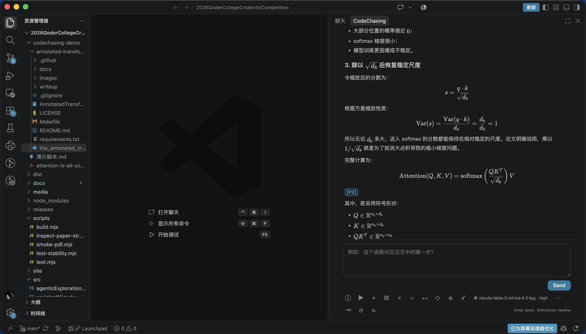
图：问"缩放点积注意力为什么除以 sqrt(d_k)？"，回答中出现 [P2] 这类可点击引用标签。
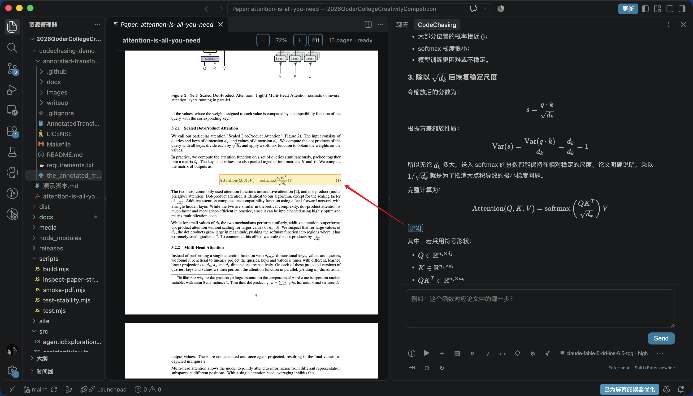
图：点击 [P2] 后 PDF 打开并高亮公式 (1) 原文（红箭头指引用处）。
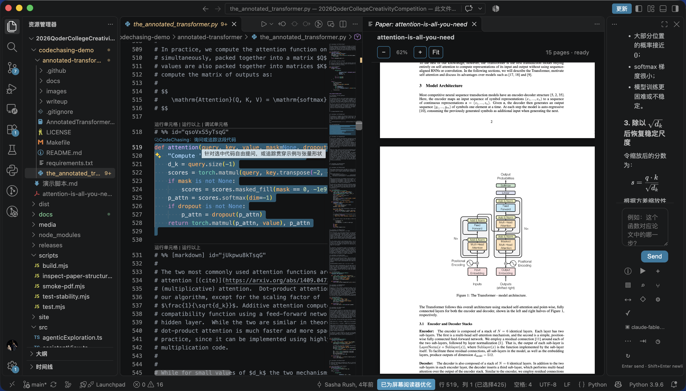
图：选中代码即出现"询问或追踪这段代码"入口。
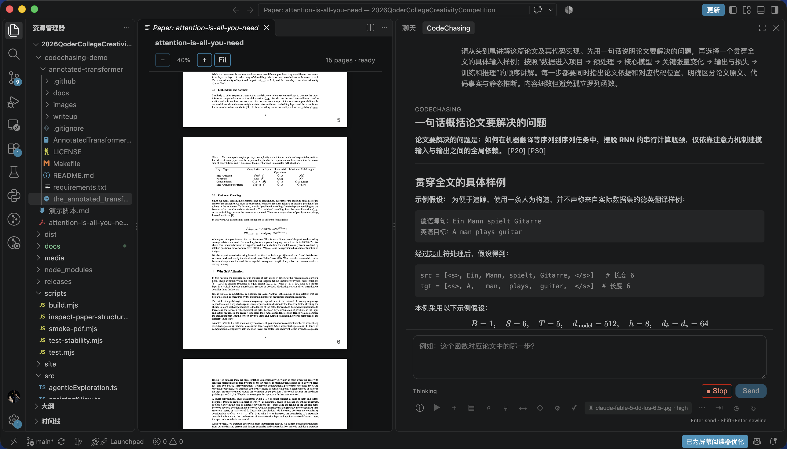
图：一键"从论文到代码"精读：先建立贯穿全文的具体样例，再逐步讲解。

## 五、Qoder 使用过程（开发与部署）

整个过程在 Qoder 中按"实现 → 测试 → 发布门禁 → 打包 → 发布 → 部署 → 文档"完成：

1. **功能实现**：用 Qoder 实现并迭代对话历史压缩（窗口 + 增量摘要）、BM25 证据检索、模型 listwise 重排、分区模型选择器（可用性检测 + 手动模型名验证）、启动自动恢复最近对话等，每项都带对应回归测试；
2. **真机问题修复**：把我真机截图反馈的问题交给 Qoder 定位并修复——PDF 打开卡 27 秒（worker 跨域加载黑箱，改主线程并行取回 + 同域 blob 启动）、缩放跳回第一页（改视口中心锚点还原）、点引用越开越挤（改固定编辑器组复用 + 游离标签清理），修完逐条真机复验；
3. **回归测试**：`npm run check` 一次跑完类型检查、Webview 语法检查、一系列可执行回归场景（检索、引用审计、流式、取消、历史压缩、重排、PDF 解析、回环资源服务、缩放位置等）与构建；
4. **发布门禁**：全部检查通过才允许打包；安装包从公开仓库干净克隆重建，保证"所见即所得"；
5. **GitHub 发布**：Qoder 整理仓库、提交并发布 Releases（v0.24.3 → v0.30.3 连续迭代， changelog 58 个版本全公开）；
6. **Qoder Sites 部署**：一键部署展示站并设置公开访问，本帖顶部链接即部署结果；中途一次服务端上传故障由 Qoder 按恢复规则保留原动作重试，内容更新后重新 prepare → publish 并线上逐条验证；
7. **文档**：评委体验手册由 Qoder 逐条核对真实界面后编写并同步到仓库，版本号与 Release 保持一致。

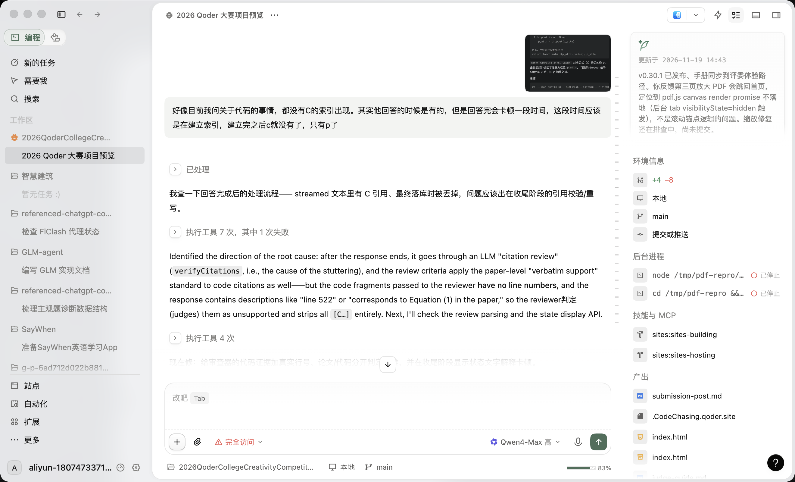
图：Qoder 会话：真机反馈"回答结束后 C 引用消失"，Qoder 定位到收尾引用审计并修复。
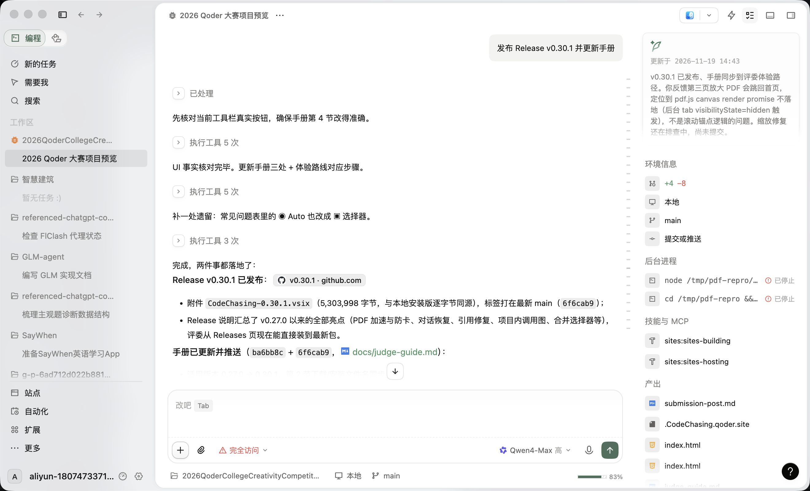
图：Qoder 会话：发布 Release 并逐条同步评委手册。
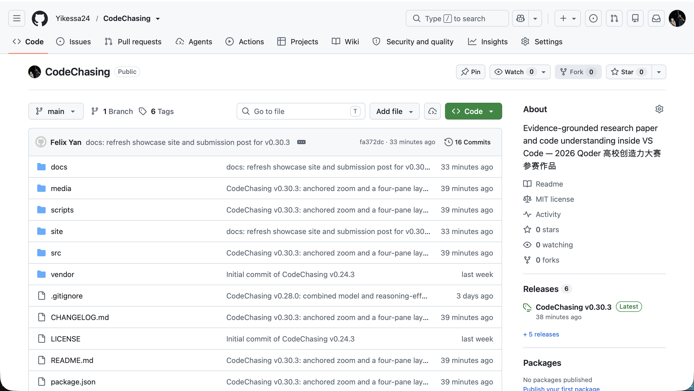
图：公开仓库共 6 个 Releases，最新 v0.30.3；安装包在 Releases 页下载。

## 六、亮点与创新

- **真实锚点**：论文引用内容寻址、保存高亮快照，PDF 重新准备后旧引用不会被悄悄改指向；
- **证据审计**：不支持的引用移除或提示，宁可说"来源不足"也不编造；
- **Agentic 探索**：回答前模型自主多轮搜索全文、跨模块读代码（默认最多 8 轮），而非只看一次检索；
- **检索与记忆**：BM25 长度归一化排序 + 模型 listwise 重排；长对话自动压缩为增量摘要，追问不丢上下文；
- **视觉理解**：扫描版 OCR；架构图 / 表格 / 公式类问题把页面图像发给视觉模型；
- **论文 ↔ 代码互证**：共引证据自动学习映射、审阅后双向精确查找；静态调用图（只含项目内定义函数）；贯穿示例的张量形状传播；
- **读得顺**：回环 HTTP 资源服务 + 主线程并行取回让 PDF 秒开且不怕卡；缩放保持阅读位置；引用跳转固定复用编辑器组，窗口始终文件树｜代码｜PDF｜助手四画面；
- **对话不丢**：启动自动恢复最近对话，历史会话切换后引用仍可点击；长对话窗口 + 增量摘要压缩；
- **隐私边界**：提取 / 检索 / 扫描全本地，API key 存 SecretStorage，自动排除 `.env` 等敏感文件，不执行代码、不上传整仓。

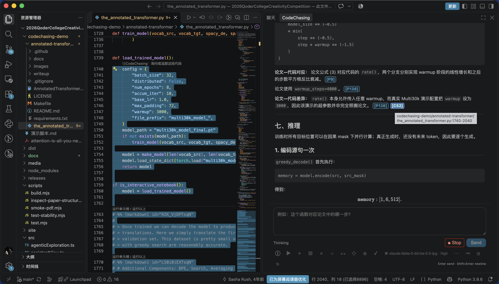
图：论文—代码对应与差异：[P] 与 [C] 引用同屏。
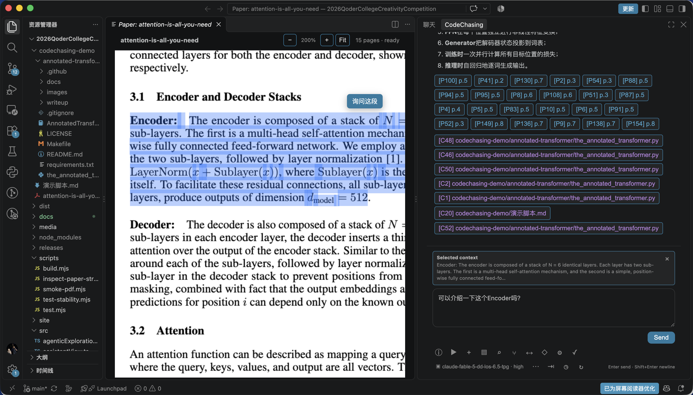
图：200% 缩放下划选段落即出现"询问这段"；右侧为本轮引用标签列表。
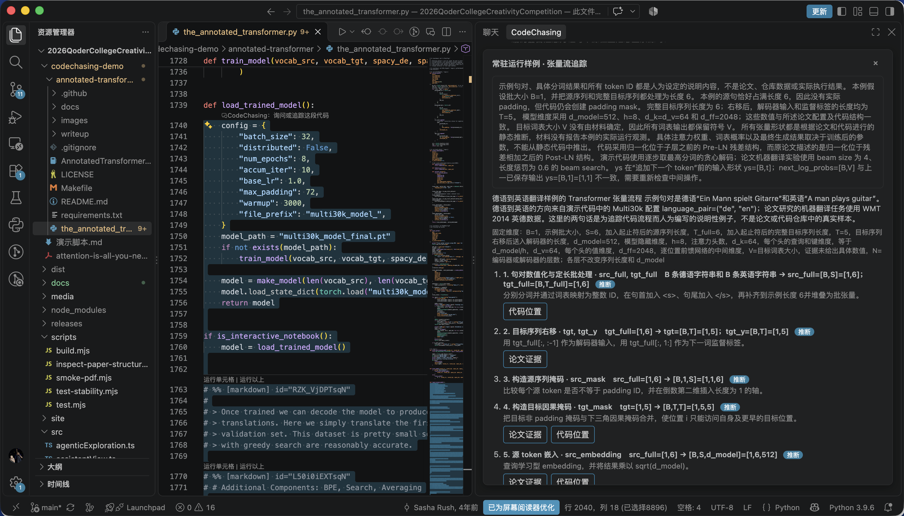
图：贯穿运行样例·张量流追踪面板：逐步状态与形状，带"推断"标记与证据按钮。
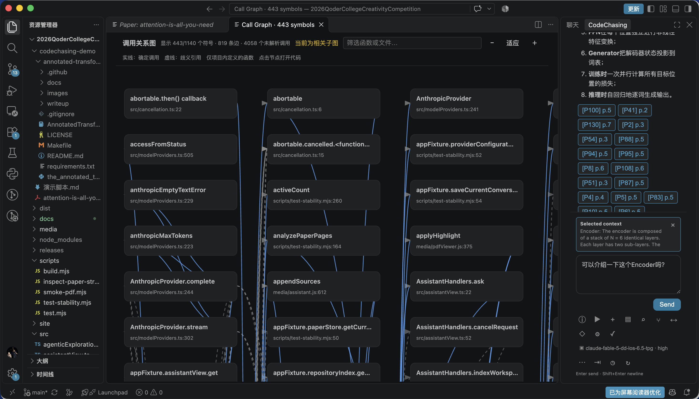
图：项目内调用图：实线确定调用、虚线歧义引用，点击节点打开代码。
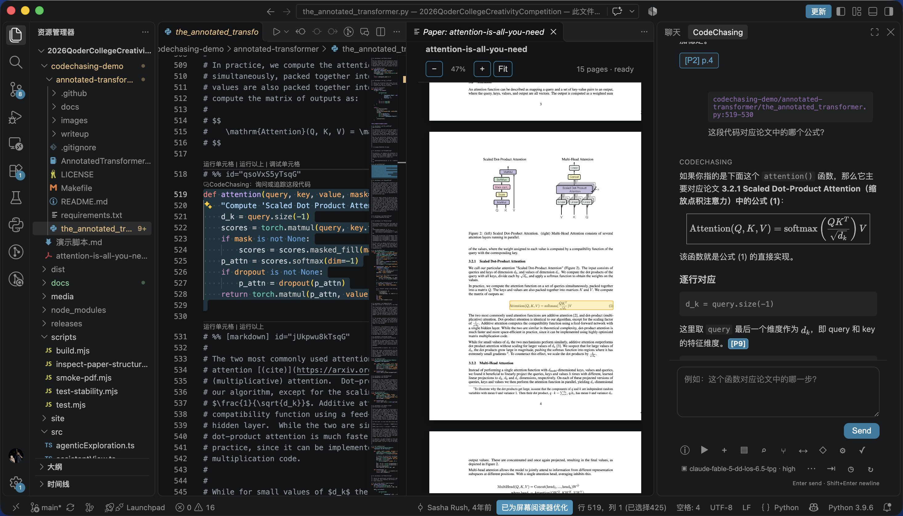
图：选中代码反查论文公式、点 [P] 高亮后，窗口仍保持文件树｜代码｜PDF｜助手四画面。

## 七、结果与验证

所有结果公开可查：

| 结果 | 地址 |
| --- | --- |
| 展示站（Qoder Sites，公开） | https://codechasing-7g1tq161nl3.qoder.zone |
| 开源仓库 | https://github.com/Yikessa24/CodeChasing |
| 安装包 | https://github.com/Yikessa24/CodeChasing/releases/tag/v0.30.3 |
| 评委手册 | https://github.com/Yikessa24/CodeChasing/blob/main/docs/judge-guide.md |

本地复现发布门禁：`git clone` → `npm install` → `npm run check`。

已知边界（手册中如实说明）：OCR 高亮框不如原生文本精确；视觉问题依赖视觉模型；静态调用分析把歧义调用标为低置信。
